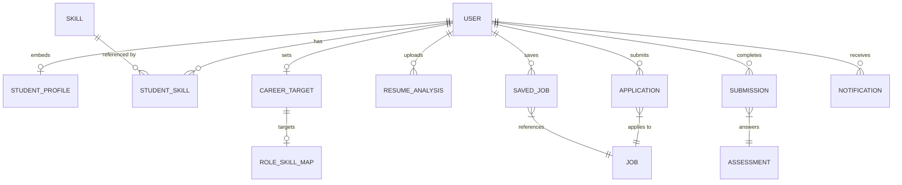

# NEXORA Student Database Architecture

## 1. Core Identity & Authentication
- **User (`User.js`)**: The canonical source of truth for all users.
  - Contains authentication fields (`email`, `password`, `googleId`, `role`).
  - Embeds `studentProfile` for core academic and basic profile information (`college`, `branch`, `batchYear`, `cgpa`, `bio`, `projects`, `certificates`).

## 2. Normalized Entities (To Be Implemented)
- **Skill (`Skill.js`)**: Normalized dictionary of skills (e.g., "React", "Node.js").
- **StudentSkill (`StudentSkill.js`)**: Join table mapping `User._id` to `Skill._id`, including proficiency and source.
- **CareerTarget (`CareerTarget.js`)**: Stores a student's career goals, linking to `RoleSkillMap` roles.
- **SavedJob (`SavedJob.js`)**: Bookmarks for jobs a student is interested in.

## 3. Existing Related Entities
- **Resume (`ResumeAnalysis.js`)**: Stores parsed resume data, ATS score, and S3/file URLs. Links to `User._id`.
- **Application (`Application.js`)**: Tracks job applications. Links `User._id` to `Job._id`.
- **Assessment Results (`Submission.js`)**: Tracks assessment attempts and scores. Links `User._id` to `Assessment._id`.
- **Alumni Interactions (`MentorshipSession.js`)**: Tracks sessions between Students and Alumni.
- **Notifications (`Notification.js`)**: System and application notifications. Links to `User._id`.

## 4. Entity Relationship Diagram (Conceptual)

## 5. Security & Authorization
- **Data Isolation**: API controllers must validate `req.user.id` against the `studentId` of requested resources.
- **Placement Access**: Placement users can read limited Student views (e.g., matching profiles) but cannot mutate student profiles.
